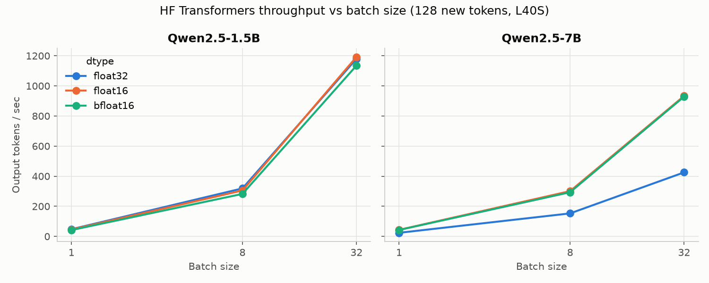
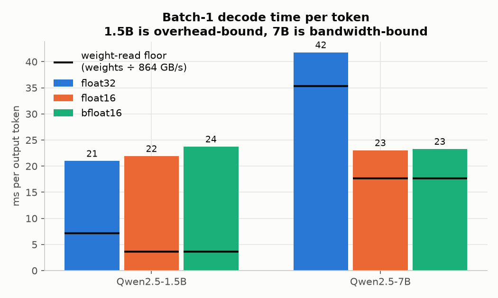
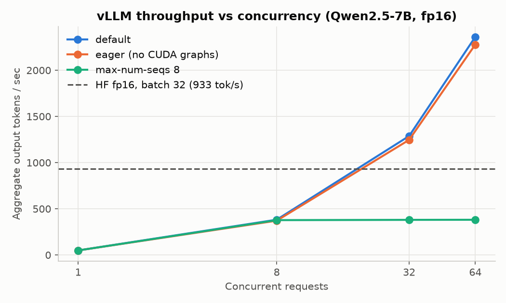
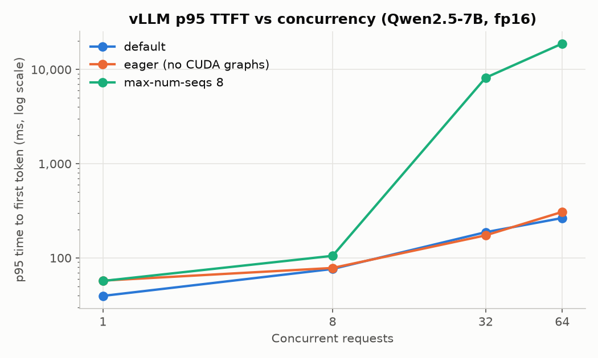

# llm-inference-benchmark

Benchmarks LLM inference on a single GPU: **Hugging Face Transformers** across precisions and batch sizes, then a **vLLM** server under concurrent streaming load, plus a quick check that faster settings don't change the model's answers. Prompts are synthetic healthcare tasks (Medicare benefit questions, short made-up clinical notes to summarize). No real patient data.

## Setup

| | |
|---|---|
| GPU | NVIDIA L40S, 46 GB (~864 GB/s memory bandwidth) |
| Software | Python 3.12, PyTorch 2.14 (CUDA 13.0), Transformers 5.22, vLLM 0.34 |
| Models | `Qwen/Qwen2.5-1.5B-Instruct`, `Qwen/Qwen2.5-7B-Instruct` |

```bash
python -m venv .venv && source .venv/bin/activate
pip install -r requirements.txt
```

## Scripts

| File | What it does |
|---|---|
| `prompts.py` | 20 synthetic healthcare prompts |
| `hf_benchmark.py` | HF `generate()`: float32 / float16 / bfloat16 × batch 1 / 8 / 32, 128 greedy tokens, 1 warmup + 3 timed runs |
| `vllm_benchmark.py` | Async streaming client for a vLLM server: concurrency 1 / 8 / 32 / 64, measures TTFT, latency, tokens/sec |
| `quality_check.py` | 100 PubMedQA questions (yes / no / maybe): accuracy and agreement with fp32 |
| `make_plots.py` | Plots from `results/*.csv` into `results/plots/` |

```bash
# HF Transformers
python hf_benchmark.py                                   # 1.5B (default)
python hf_benchmark.py --model Qwen/Qwen2.5-7B-Instruct

# vLLM: start a server, then run the client against it
vllm serve Qwen/Qwen2.5-7B-Instruct --dtype float16      # + --enforce-eager, or --max-num-seqs 8
python vllm_benchmark.py --config-name default            # eager / small_batch

# Quality (stop the vLLM server for the HF runs)
python quality_check.py --backend hf-fp32
python quality_check.py --backend hf-fp16
python quality_check.py --backend vllm                    # needs the default vLLM server running

python make_plots.py
```

Every vLLM request uses `temperature=0` and `ignore_eos=True`. Every HF run uses `min_new_tokens = max_new_tokens = 128`. So every request produces exactly 128 tokens.

## Results

### HF Transformers: precision and batching

| Model | dtype | ms/token (batch 1) | tok/s (batch 1) | tok/s (batch 32) | Peak memory |
|---|---|---|---|---|---|
| 1.5B | float32 | 21.0 | 47.6 | 1180 | 6.2 GB |
| 1.5B | float16 | 21.9 | 45.6 | 1193 | 3.1 GB |
| 1.5B | bfloat16 | 23.8 | 42.1 | 1135 | 3.1 GB |
| 7B | float32 | 41.8 | 23.9 | 425 | 30.5 GB |
| 7B | float16 | 23.1 | 43.4 | 933 | 15.3 GB |
| 7B | bfloat16 | 23.3 | 42.9 | 929 | 15.3 GB |

| Speedup | 1.5B | 7B |
|---|---|---|
| float16 vs float32 (same batch size) | 0.96x / 0.96x / 1.01x | **1.82x / 1.97x / 2.19x** |
| batch 32 vs batch 1 (float16) | 26.2x | 21.5x |
| Memory, float16 vs float32 | −50% | −50% |

Precision speedups are listed for batch sizes 1 / 8 / 32. Full data: `results/hf_results_*.csv`.




### vLLM server (7B, float16)

| Config | Concurrency | tok/s | p50 / p95 TTFT | p50 / p95 latency |
|---|---|---|---|---|
| default | 1 | 49 | 35 / 40 ms | 2.60 / 2.60 s |
| default | 64 | **2361** | 160 / 265 ms | 3.44 / 3.54 s |
| eager (no CUDA graphs) | 64 | 2278 | 201 / 308 ms | 3.58 / 3.66 s |
| max-num-seqs 8 | 64 | 381 | 18.8 / 18.9 s | 21.5 / 21.5 s |

vLLM 0.34 defaults on this GPU: `max-num-seqs` 256, prefix caching on, CUDA graphs on. Full data for concurrency 1, 8, 32 and 64: `results/vllm_results.csv`.




### Quality (7B, 100 PubMedQA questions)

| Backend | Accuracy | Same answer as HF fp32 | Unparseable answers |
|---|---|---|---|
| HF float32 | 50% | — | 0 |
| HF float16 | 50% | 100% | 0 |
| vLLM default (float16) | 50% | 100% | 0 |

## Key findings

1. **Half precision helps only when decoding is limited by memory bandwidth.** Each decode step reads every weight once. For 7B in float32 that is 30.5 GB, which takes at least ~35 ms per token at 864 GB/s. The measured 41.8 ms is close to that, so float16 nearly halves the time (23.1 ms, **1.8–2.2x** faster). For 1.5B the same floor is only ~7 ms, which is far below the ~21 ms/token that HF's Python loop and kernel launches take regardless. So precision changes nothing there (0.88–1.01x). Either way it halves memory.
2. **Batching is the biggest lever in HF.** Batch 32 gives **18–27x** the throughput of batch 1, while each request takes only 19–80% longer.
3. **vLLM gives 2.5x HF's best.** The default server reaches **2361 tok/s** at 64 concurrent requests, compared with 933 tok/s for HF float16 at batch 32. At the same parallelism (32) it is 1.38x.
4. **Continuous batching is where vLLM's gains come from.** With `--max-num-seqs 8`, throughput stays flat at ~380 tok/s past 8 requests, and p95 TTFT goes from 265 ms to **18.9 s** at concurrency 64 because requests wait in a queue. With the default settings, p95 latency only grows from 2.60 s to 3.54 s between 1 and 64 concurrent requests.
5. **CUDA graphs add only ~4% for 7B.** Default vs `--enforce-eager` is 1.00–1.04x on throughput, plus 40 vs 57 ms p95 TTFT at concurrency 1. vLLM's eager path (20.3 ms/token) is already close to the bandwidth floor (~17.6 ms), so there is little launch overhead left to remove.
6. **Faster settings didn't change the answers.** HF float16 and vLLM gave the same answer as HF float32 on all 100 questions. The 50% accuracy is the model's own: it answers "maybe" 43 times, though only 16 of the labels are "maybe". 20 of the 26 "no" questions get "maybe".

## Limitations

- One GPU and one run per configuration. There are no error bars, and run-to-run noise is a few percent.
- The 20 synthetic prompts repeat and prefix caching is on, so vLLM's TTFT is optimistic because most prefill is served from cache. The prompts are also short (36–91 tokens).
- Every output is a fixed 128 tokens (`ignore_eos`). Real traffic has mixed lengths, and longer outputs put more pressure on the KV cache.
- HF numbers are measured inside the Python process for a whole batch. vLLM numbers include HTTP and streaming time across concurrent requests.
- The quality check is coarse: one-word answers on 100 questions. It would miss smaller differences in long generations.

## Next steps

- Quantization: FP8 (the L40S supports it natively) and AWQ 4-bit, measuring both speed and the quality check.
- Monitoring: scrape vLLM's Prometheus `/metrics` endpoint (queue length, KV-cache usage, batch size) during load tests.
- Varied prompt and output lengths, including long-context prompts that stress prefill and the KV cache.
